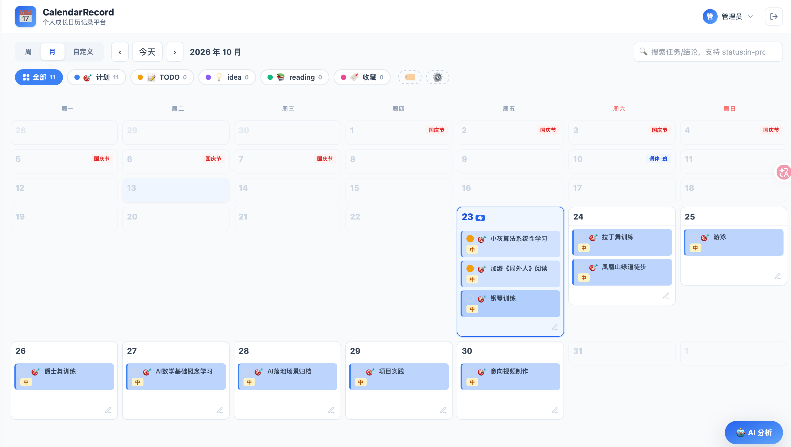
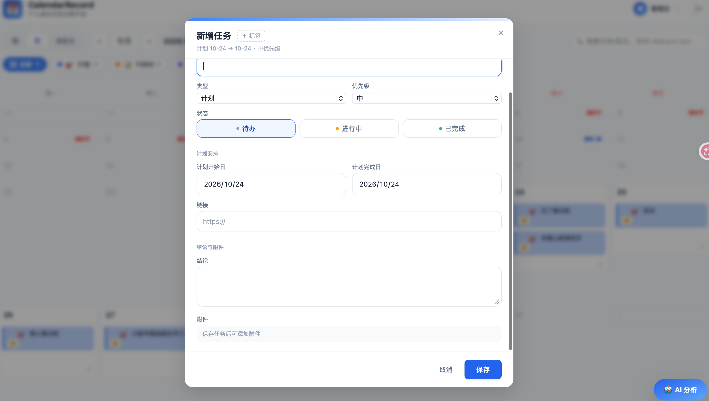
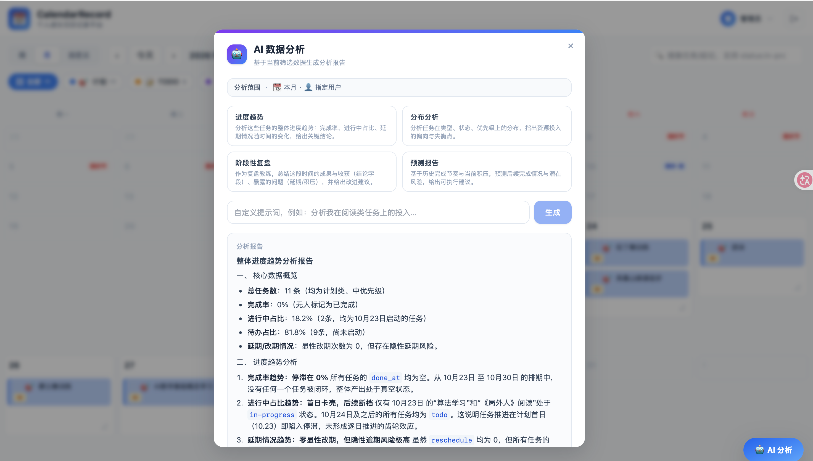

# CalendarRecord 个人成长日历

以日历为核心的个人成长记录平台：把计划、TODO、idea、阅读与收藏统一放到同一张日历上，跟踪进度与收获，并借助 AI 对当前筛选数据做趋势与复盘分析。

---

## 一、背景

日常的计划与产出往往散落在待办应用、笔记、浏览器收藏夹里：任务看不到时间分布，阅读与灵感无法沉淀，复盘时也缺少连续的数据。CalendarRecord 试图解决三个问题：

- **记录入口分散**：用「日历」作为唯一时间轴，所有类型的信息按计划日期落位，跨天任务以甘特跨度呈现。
- **进度不可见**：延期自动高亮、改期次数统计、完成度圆环，让"计划 vs 实际"一眼可见。
- **复盘成本高**：按日生成杂志式「成长日报」，并支持 AI 对流式数据做趋势、分布、阶段复盘与预测。

产品面向个人或 ≤5 人的小团队：管理员预置，自助注册人数上限 5 人，数据按账号严格隔离。

---

## 二、结果

|  |  |
| :--: | :--: |
|  |  |
|  |  |

---

## 三、核心技术点

```text
浏览器 SPA：React 18 + TypeScript + Vite + Tailwind + TanStack Query
  日历视图 / 报刊日报 / 标签云 / 搜索 / AI 分析面板
        │  HTTPS：REST(JSON) / SSE
        ▼
Caddy：自动 HTTPS + SPA 静态托管 + /api/* 反向代理
        ▼
FastAPI (uvicorn)：routers = auth / types / tasks / files / ai
  JWT httpOnly Cookie · owner_id 数据隔离 · 纯逻辑层 logic.py
        │
        ├── SQLite (WAL)：db.sqlite + JSON 扩展字段
        ├── 本地卷 /data：db.sqlite + uploads
        └── 智谱 GLM API：OpenAI 兼容 / SSE
```

---

## 四、部署说明

### 方式一：Docker Compose（推荐）

前置条件：Docker 与 Docker Compose，服务器开放 80 / 443 端口。

```bash
cp .env.example .env   # 按需修改配置
docker compose up -d --build
```

默认访问 `http://localhost`，默认管理员账号 `admin / admin123`。

关键环境变量：

| 变量 | 说明 |
| :-- | :-- |
| `SITE_ADDRESS` | 站点地址。域名则自动签发 HTTPS；本地填 `localhost`；仅有 IP 时填 `http://<IP>` |
| `JWT_SECRET` | JWT 签名密钥，生产务必改为随机长字符串 |
| `COOKIE_SECURE` | HTTPS 下为 `true`，本地 HTTP 调试为 `false` |
| `CORS_ORIGINS` | 跨域来源，同源部署留空 |
| `ADMIN_USERNAME` / `ADMIN_PASSWORD` | 预置管理员账号，生产请修改密码 |
| `GLM_API_KEY` / `GLM_BASE_URL` / `GLM_MODEL` | 智谱 GLM 配置，不填则 AI 分析返回友好提示 |

服务组成：

```
caddy :80/:443  前端静态资源 + SPA 回退 + /api/* 反代 api:8000，按 SITE_ADDRESS 自动 HTTPS
api   :8000     uvicorn 运行 FastAPI，DATA_DIR=/data
volumes         cr_data（db.sqlite + uploads）、caddy_data、caddy_config
```

数据持久化：数据库与上传文件均落在 `cr_data` 卷，`docker compose down` 不会丢数据；备份复制该卷中的 `db.sqlite` 即可。

常用运维命令：

```bash
docker compose logs -f        # 查看日志
docker compose down           # 停止服务
docker compose up -d --build  # 代码更新后重建
docker compose down -v        # 停止并删除数据卷（谨慎）
```

### 方式二：本地开发调试

依赖 Python 3.12+、Node.js 20+。

```bash
# 后端
cd backend
python -m venv .venv && source .venv/bin/activate
pip install -r requirements.txt
uvicorn app.main:app --host 0.0.0.0 --port 8000 --reload

# 前端（新终端）
cd frontend
npm install
npm run dev   # http://localhost:5173，/api 已代理到 127.0.0.1:8000
```

首次启动自动建表并初始化管理员与内置类型，数据库位于 `backend/data/db.sqlite`。

### 测试

```bash
cd backend && pytest
cd frontend && npm test
```

更完整的部署与排障说明见 [部署指南.md](docs/部署指南.md)，架构细节见 [技术架构-实现版.md](docs/技术架构-实现版.md)。
